# Flow ระบบร้านสานะกิมหยง

เอกสารนี้อธิบายพฤติกรรมจากโค้ดปัจจุบันของโปรเจ็กต์ ครอบคลุม Admin, Employee, User และผู้เยี่ยมชมที่ยังไม่ล็อกอิน

## 1. ภาพรวมระบบ

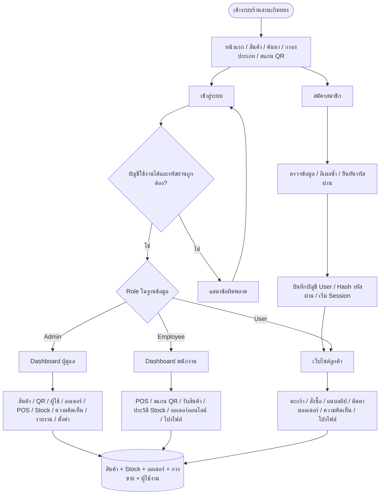

ผู้เยี่ยมชมดูสินค้า ราคา จำนวนพร้อมขาย และสแกน QR ได้ การเพิ่มสินค้าในตะกร้าหรือทำรายการส่วนตัวต้องล็อกอินก่อน การสมัครสมาชิกผ่านหน้าเว็บไซต์สร้าง Role `user` เสมอ

## 2. การล็อกอินและตรวจสิทธิ์

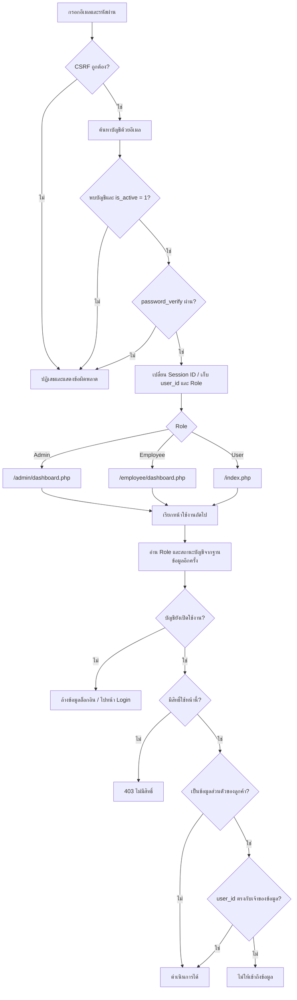

ข้อกำหนด:

- หน้าภายใต้ `/admin/` ตรวจว่าเป็น Admin แม้ผู้เรียกจะเป็น Employee ที่มีสิทธิ์ใช้ฟังก์ชันใกล้เคียงกัน
- Employee ใช้หน้าภายใต้ `/employee/` และไม่ได้รับราคาทุนหรือกำไรใน HTML
- การระงับบัญชีมีผลกับ Session เดิมเมื่อเรียกหน้าที่ตรวจบัญชีครั้งถัดไป
- การแก้ข้อมูลผ่านฟอร์มตรวจ CSRF ฝั่งเซิร์ฟเวอร์
- ออเดอร์และความคิดเห็นของลูกค้ากรองด้วย `user_id` ของผู้ล็อกอิน
- สลิปเปิดผ่าน `slip.php` โดยเจ้าของออเดอร์ หรือ Admin/Employee ที่ตรวจการชำระเงิน ไฟล์ในโฟลเดอร์สลิปถูกปิดการเข้าถึงโดยตรง

## 3. สมัครสมาชิกและโปรไฟล์

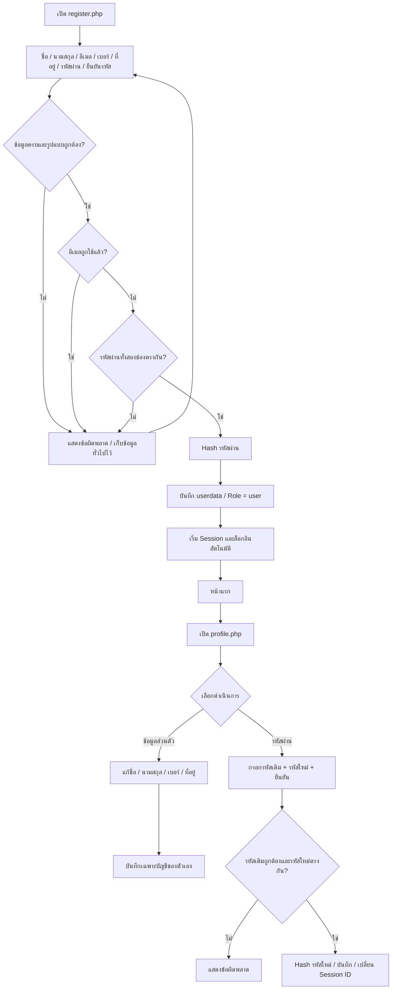

Admin เป็นผู้กำหนด Role ของบัญชีผ่านหน้าจัดการผู้ใช้งาน การเปลี่ยนโปรไฟล์และการสมัครสมาชิกไม่ให้ผู้ใช้เปลี่ยน Role เอง

## 4. ลูกค้าเลือกสินค้าและจัดการตะกร้า

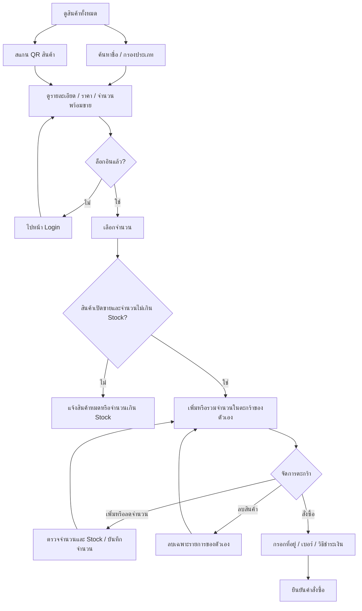

**การใส่ตะกร้ายังไม่ตัด Stock** ระบบตรวจและตัด Stock อีกครั้งเมื่อยืนยันคำสั่งซื้อ ราคาที่หน้าเว็บใช้แสดงผลจะถูกตรวจจากฐานข้อมูลอีกครั้งตอนบันทึกจริง

## 5. สร้างคำสั่งซื้อออนไลน์และชำระเงิน

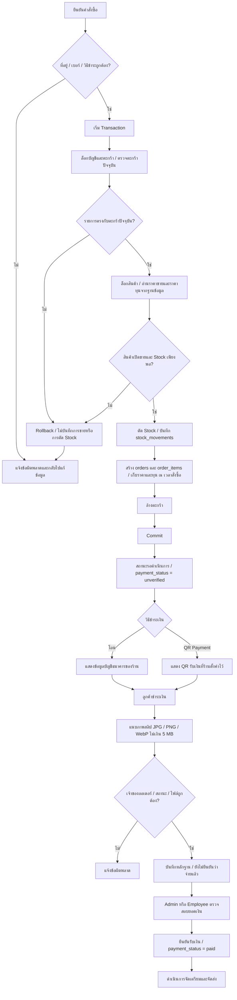

การแนบสลิปไม่เปลี่ยนสถานะเป็นชำระแล้วอัตโนมัติ เจ้าหน้าที่ต้องยืนยันเอง ระบบปัจจุบันให้เจ้าหน้าที่เริ่มจัดเตรียมก่อนตรวจการชำระเงินได้ แต่ห้ามเปลี่ยนเป็นจัดส่งแล้วหรือสำเร็จหากยังไม่ยืนยันรับเงิน

## 6. สถานะออเดอร์ออนไลน์

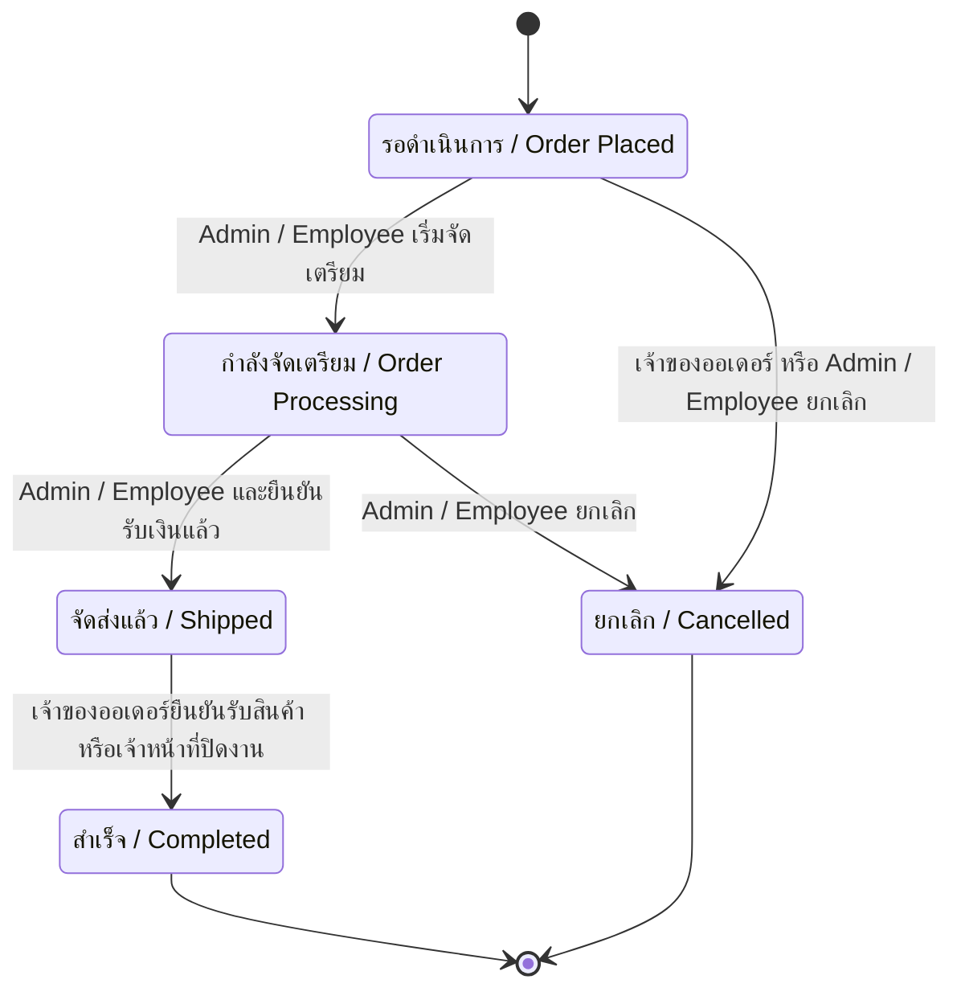

| สถานะปัจจุบัน | สถานะถัดไปที่อนุญาต | ผู้ดำเนินการ |
|---|---|---|
| รอดำเนินการ | กำลังจัดเตรียม | Admin / Employee |
| รอดำเนินการ | ยกเลิก | Admin / Employee / เจ้าของออเดอร์ |
| กำลังจัดเตรียม | จัดส่งแล้ว | Admin / Employee และต้องตรวจการชำระแล้ว |
| กำลังจัดเตรียม | ยกเลิก | Admin / Employee |
| จัดส่งแล้ว | สำเร็จ | Admin / Employee / เจ้าของออเดอร์ และต้องตรวจการชำระแล้ว |
| สำเร็จ / ยกเลิก | ไม่มี | ระบบไม่ให้ย้อนสถานะ |

หมายเลขติดตามพัสดุบันทึกโดย Admin/Employee ในออเดอร์ที่ยังไม่สำเร็จหรือยกเลิก และลูกค้าเปิดดูจากรายละเอียดออเดอร์ของตัวเอง

## 7. ยกเลิกออเดอร์และคืน Stock

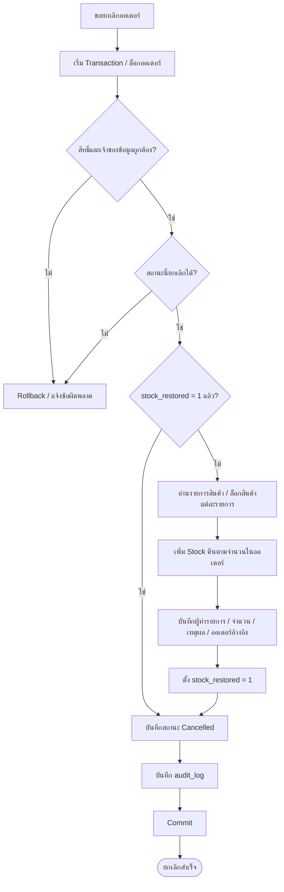

ออเดอร์ที่ยกเลิกแล้วเป็นสถานะสุดท้าย การส่งคำขอซ้ำจึงถูกปฏิเสธ และมี `stock_restored` ช่วยป้องกันการคืน Stock ซ้ำ สำหรับออเดอร์ยกเลิกที่นำเข้าจากข้อมูลเก่า ระบบตั้งธงว่าจัดการ Stock แล้ว เพื่อไม่คืนสินค้าโดยไม่มีหลักฐานย้อนหลัง

## 8. ขายหน้าร้าน / POS

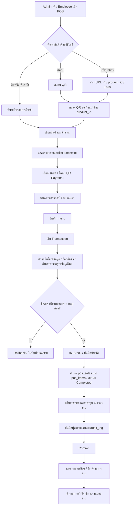

QR สินค้าใช้ค้นหาสินค้า ส่วน QR Payment ใช้ชำระเงิน เป็นข้อมูลคนละชุด พนักงานเห็นราคาขายและยอดรวม แต่ไม่เห็นทุนหรือกำไร การยืนยัน POS ถือว่าร้านได้รับเงินแล้ว ไม่มีการตรวจยอดกับธนาคารอัตโนมัติ

### แก้ไขการขายหน้าร้าน

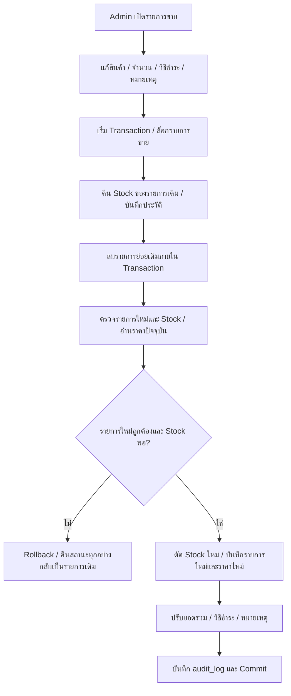

Employee เพิ่มการขายได้ แต่แก้รายการขายเดิมไม่ได้ การแก้ POS โดย Admin คำนวณรายการใหม่ด้วยราคาสินค้าปัจจุบัน ส่วนการแก้ราคาสินค้าเพียงอย่างเดียวไม่เปลี่ยนราคาที่บันทึกไว้ในรายการขายเดิม

## 9. สินค้า / Stock / QR

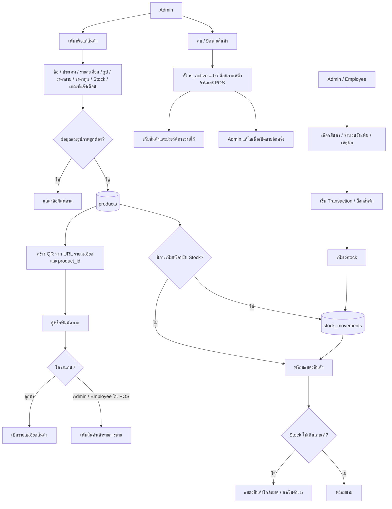

ประวัติ Stock เก็บ `product_id`, ผู้ทำรายการ, จำนวนเพิ่ม/ลด, ยอดหลังปรับ, เหตุผล, เอกสาร/รายการอ้างอิง และวันที่เวลา ทุกช่องทางใช้ Stock ของสินค้าเดียวกัน

## 10. ผู้ใช้งาน / พนักงาน / Role

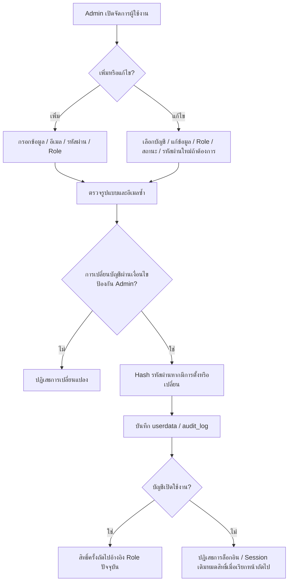

Admin ไม่สามารถระงับหรือลดสิทธิ์บัญชี Admin ที่กำลังใช้งานอยู่ และระบบต้องมี Admin ที่เปิดใช้งานอย่างน้อยหนึ่งบัญชี ฟังก์ชันนี้ไม่ได้ลบบัญชีและประวัติการทำรายการ

## 11. ความคิดเห็นและคำตอบจากร้าน

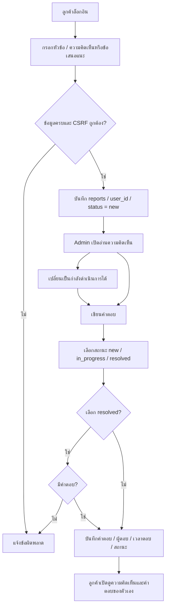

Employee ไม่มีสิทธิ์ใช้หน้าความคิดเห็นหรือตอบกลับลูกค้า

## 12. รายงานยอดขาย / ต้นทุน / กำไร / Stock

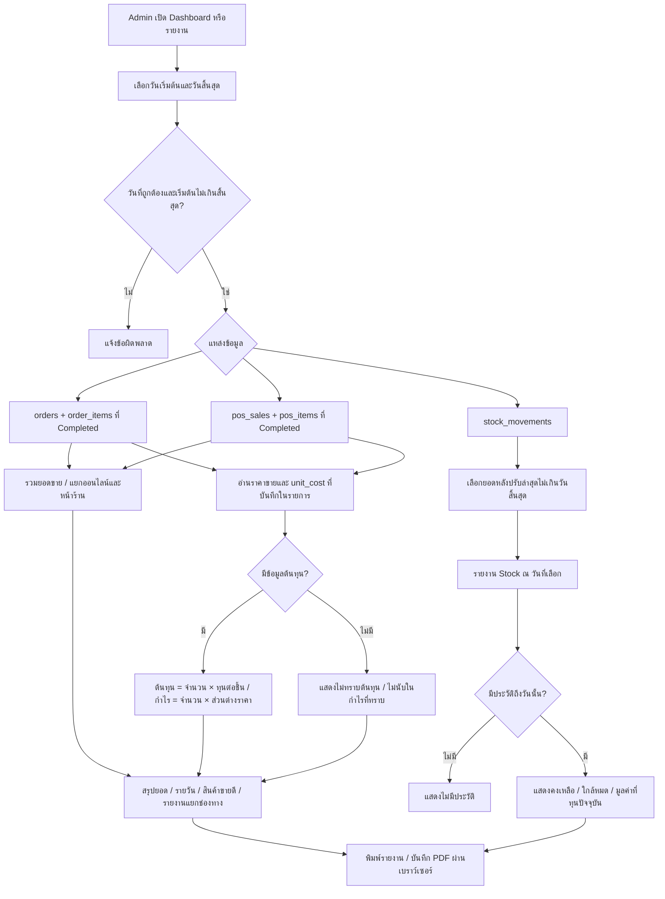

หลักการคำนวณ:

- **ยอดขาย:** ยอดรวมของรายการสำเร็จ ภายในช่วงวันที่ของรายการขาย (`order_date` สำหรับออนไลน์ และ `created_at` สำหรับ POS)
- **ต้นทุนที่ทราบ:** ผลรวม `quantity × unit_cost` เฉพาะรายการที่มีต้นทุน
- **กำไรที่ทราบ:** ผลรวม `quantity × (price − unit_cost)` เฉพาะรายการที่มีต้นทุน เป็นกำไรจากส่วนต่างสินค้า ยังไม่หักค่าเช่า ค่าแรง หรือค่าใช้จ่ายอื่น
- **สินค้าขายดี:** รวมจำนวนขายจากทั้งสองช่องทาง เฉพาะรายการสำเร็จ
- **Stock ตามวันที่:** ใช้ยอดคงเหลือจากประวัติ Stock ณ สิ้นสุดวันที่เลือก
- **มูลค่าสินค้าคงเหลือ:** ใช้จำนวนตามรายงานคูณราคาทุนปัจจุบัน จึงไม่ใช่มูลค่าทุนย้อนหลัง ณ วันที่เลือก
- **ข้อมูลเดิม:** ไม่มีการเดาราคาทุนย้อนหลัง วันที่ก่อนเริ่มเก็บประวัติ Stock จะแสดงว่าไม่มีประวัติ

## 13. การเชื่อมโยงข้อมูล

แผนภาพนี้เป็นความสัมพันธ์เชิงตรรกะของระบบ ไม่ได้หมายความว่าทุกเส้นมี Foreign Key บังคับในฐานข้อมูล

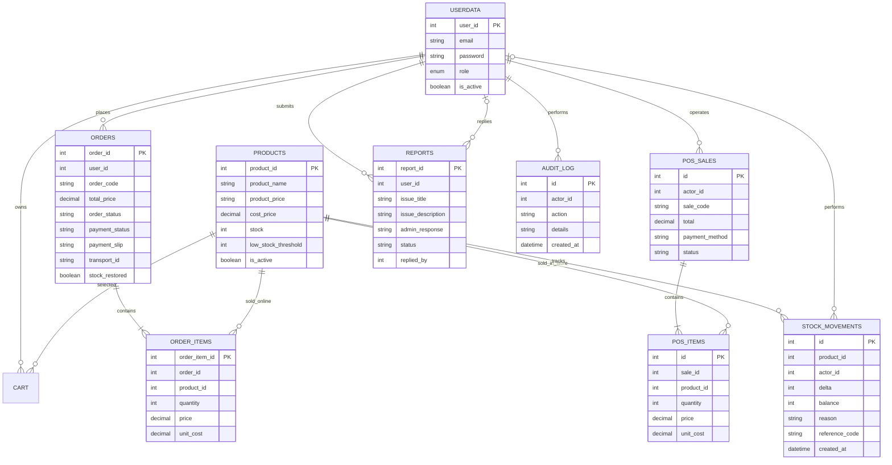

`shop_settings` เก็บข้อมูลบัญชีธนาคารและภาพ QR รับเงิน ส่วน QR สินค้าสร้างจาก URL และ `product_id` โดยไม่ต้องมีตาราง QR แยก `product_price` ในฐานข้อมูลเดิมเป็น VARCHAR แต่ระบบตรวจเป็นจำนวนเงินและคำนวณการขายด้วยหน่วยสตางค์

## 14. หน้าจอและสิทธิ์

| งาน | Admin | Employee | User / ผู้เยี่ยมชม |
|---|---|---|---|
| สินค้าและ QR สำหรับดูรายละเอียด | ได้ | ได้ | ได้โดยไม่ต้องล็อกอิน |
| Dashboard | ของ Admin | ของ Employee | ไม่มี |
| จัดการสินค้า / ทุน / ราคา / พิมพ์ QR | ได้ | ไม่ได้ | ไม่ได้ |
| POS ใหม่ | ได้ | ได้ | ไม่ได้ |
| แก้ POS เดิม | ได้ | ไม่ได้ | ไม่ได้ |
| ประวัติ POS | ทั้งร้าน | รายการที่ตัวเองทำ | ไม่ได้ |
| Stock / รับสินค้า / ประวัติ | ได้ | ได้ | ดูเฉพาะจำนวนพร้อมขายในหน้าสินค้า |
| ออเดอร์ออนไลน์ของร้าน / ตรวจเงิน / เตรียม / จัดส่ง | ได้ | ได้ | ไม่ได้ |
| ซื้อสินค้าและติดตามออเดอร์ของตัวเอง | ได้ | ได้ | ต้องล็อกอิน |
| ความคิดเห็น | จัดการและตอบ | ไม่ได้ | ส่งและดูของตัวเองเมื่อล็อกอิน |
| ผู้ใช้งาน / Role / ระงับบัญชี | ได้ | ไม่ได้ | ไม่ได้ |
| รายงานทุนและกำไร / ตั้งค่ารับเงิน | ได้ | ไม่ได้ | ไม่ได้ |
| โปรไฟล์ / เปลี่ยนรหัสผ่าน | ของตัวเอง | ของตัวเอง | ของตัวเองเมื่อล็อกอิน |

| Role / งาน | URL |
|---|---|
| เข้าสู่ระบบ | `/login.php` |
| สมัครสมาชิก | `/register.php` |
| สินค้า / รายละเอียด / สแกน | `/products.php`, `/product_content.php?id=...`, `/scan.php` |
| ตะกร้า | `/cart.php` |
| ออเดอร์ลูกค้า | `/order.php`, `/order_detail.php?order_id=...` |
| ความคิดเห็นลูกค้า | `/report_user.php` |
| โปรไฟล์ | `/profile.php` |
| Dashboard Admin / Employee | `/admin/dashboard.php`, `/employee/dashboard.php` |
| POS Admin / Employee | `/admin/pos.php`, `/employee/pos.php` |
| การขายหน้าร้าน | `/admin/sales.php`, `/employee/sales.php` |
| ออเดอร์ร้าน | `/admin/orders.php`, `/employee/orders.php` |
| Stock / ประวัติ | `/admin/stock.php`, `/employee/stock.php`, `/admin/stock_history.php`, `/employee/stock_history.php` |
| จัดการสินค้า / QR | `/admin/products.php`, `/admin/qr.php` |
| ผู้ใช้งาน | `/admin/users.php` |
| ความคิดเห็นร้าน | `/admin/feedback.php` |
| รายงาน / ตั้งค่ารับเงิน | `/admin/reports.php`, `/admin/settings.php` |

## 15. ตัวอย่าง Stock และกำไร

สมมติสินค้า A มี Stock 20 ชิ้น ราคาขาย 100 บาท และทุน 60 บาท

| เหตุการณ์ | จำนวนเปลี่ยน | Stock หลังเหตุการณ์ |
|---|---:|---:|
| รับสินค้าเพิ่ม | +10 | 30 |
| ลูกค้าเพิ่มตะกร้า 3 ชิ้น | 0 | 30 |
| ลูกค้ายืนยันสั่งซื้อ 3 ชิ้น | -3 | 27 |
| พนักงานขาย POS 2 ชิ้น | -2 | 25 |
| ยกเลิกออเดอร์ออนไลน์ 3 ชิ้น | +3 | 28 |
| ส่งคำขอยกเลิกเดิมซ้ำ | 0 | 28 |

หลังยกเลิกออนไลน์ เหลือยอดขายสำเร็จจาก POS 200 บาท ต้นทุน 120 บาท และกำไรจากสินค้า 80 บาท ออเดอร์ออนไลน์ที่ถูกยกเลิกไม่รวมในยอดขายสำเร็จ
